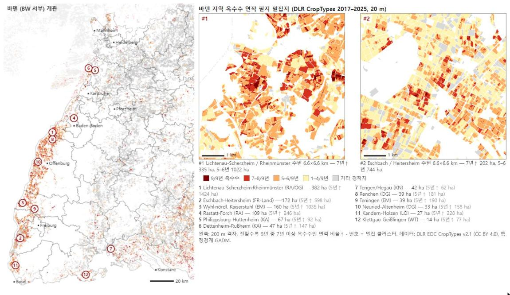
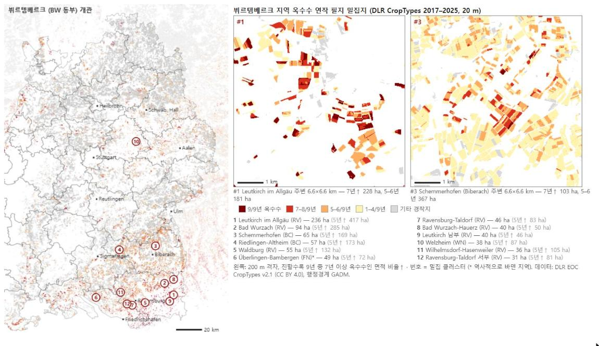

# 바덴-뷔르템베르크 옥수수 연작 필지 밀집지 분석 (바덴 · 뷔르템베르크)

- 작성일: 2026-11-05
- 분석 기간: 2017–2025 (9개 연도)
- 분석 범위: Baden-Württemberg 전역 (바덴·뷔르템베르크로 나눠 정리)

---

## 1. 요약

- 바덴과 뷔르템베르크 모두 같은 작물을 몇 년씩 이어 심는 연작은 사실상 **옥수수 하나**예요.
- 두 지역은 연작 방식이 달라요.

| 구분 | 바덴 (서부) | 뷔르템베르크 (동부) |
|---|---|---|
| 대표 밀집지 | Lichtenau–Rheinmünster (Rastatt/Ortenau) | Leutkirch·Bad Wurzach (Ravensburg, 서부 Allgäu) |
| 연작 유형 | 라인 평야의 곡실용 옥수수. 옥수수 비중은 높지만 3년 중 2번 같은 식의 윤작이 흔함 | 초지 지역 낙농용 사일리지 옥수수. 몇 안 되는 밭에 매년 옥수수를 심음 |
| 경작지 (ha) | 282,049 | 497,575 |
| 5년↑ 옥수수 (ha, 경작지 대비) | 43,416 (15.4%) | 48,039 (9.7%) |
| 7년↑ 옥수수 (ha, 경작지 대비) | 5,200 (1.8%) | 6,312 (1.3%) |
| 9/9년 완전 연작 (ha) | 252 | **1,091** |

- **바덴**
  - 연작 필지는 라인강 동쪽 평야에 몰려 있어요. 북쪽 Karlsruhe 부근부터 Rastatt, Ortenau, Kaiserstuhl 주변, Markgräflerland까지 띠처럼 이어져요.
  - 1위는 **Lichtenau–Rheinmünster 일대**로, 7년↑ 옥수수가 약 382 ha예요.
  - 옥수수 해충(Maiswurzelbohrer) 규제로 같은 밭에 3년 중 2번까지만 옥수수를 심게 한 영향으로, 9년 내내 옥수수인 땅은 드물어요.
- **뷔르템베르크**
  - **Landkreis Ravensburg**가 BW 전체 1위예요. 7년↑ 옥수수 2,763 ha로 경작지의 10.9%이고, 9/9년이 789 ha예요.
  - Ravensburg의 9/9년 면적은 BW 전체 9/9년 연작(1,343 ha)의 59%를 차지해요.
  - Biberach 등 오버슈바벤 경작지대는 옥수수를 많이 심지만 대부분 돌려 심어요.
  - 북부 뷔르템베르크(Hohenlohe, Heilbronn, Ludwigsburg 등)는 연작이 거의 없어요(경작지의 0.5% 미만).

---

## 2. 분석 방법

| 항목 | 내용 |
|---|---|
| 데이터 | DLR EOC **CropTypes v2.1** (독일 전역 연간 작물분류 지도, Sentinel-1/2 기반, CC BY 4.0) |
| 연도 | 2017–2025, 9개 연도 |
| 해상도 | 원본 10 m를 **20 m 개요 레벨**(최근접 샘플링)로 읽음. 매년 같은 지점을 표본으로 쓰므로 연도별 비교에 문제가 없음 |
| 연작 정의 | 같은 화소가 **9년 중 7년 이상 옥수수**(클래스 30)일 때. 해마다 생기는 분류 오류 1–2년치를 견딜 수 있게 정한 기준 |
| 보조 지표 | 9년 중 5년 이상 옥수수 (옥수수 위주 윤작) / 9년 모두 옥수수 (완전 연작) |
| 경작지 정의 | 9년 중 6년 이상 일년생 경작 작물로 분류된 화소 (초지·과수·포도·홉 제외) |
| 밀집지 정의 | 1 km 격자에서 3×3 km 창 안의 연작 면적이 **40 ha 이상**인 칸들을 이어 붙인 클러스터. 광역 벨트는 15 ha 기준으로 따로 묶음 |
| 지명 | 각 클러스터에서 연작이 가장 몰린 1 km 칸 중심 좌표로 OSM Nominatim 역지오코딩 |
| 행정경계 | GADM 기반 Landkreis 경계 (deutschlandGeoJSON) |
| 바덴/뷔르템베르크 구분 | Kreis 단위로 근사함 (아래 8절 참고) |

---

## 3. 바덴

### 3.1 지도

- **왼쪽 (개관 지도)**
  - 200 m 격자로 그렸어요.
  - 빨간색이 진할수록 9년 중 7년 이상 옥수수인 땅의 비율이 높아요.
  - 주황색은 옥수수가 5년 이상 나온 땅, 회색은 기타 경작지예요.
  - 번호는 아래 표의 밀집지 순위예요.
- **오른쪽 (확대 지도)**
  - 밀집지 #1(Lichtenau-Scherzheim)과 #2(Eschbach)를 20 m 해상도로 확대했어요.
  - 각 화소를 9년 중 옥수수였던 연수에 따라 색칠했어요.
    - 진한 적색: 9/9년
    - 적색: 7–8/9년
    - 주황: 5–6/9년
    - 연노랑: 1–4/9년
    - 회색: 기타 경작지

### 3.2 연작 밀집지 순위

| # | 위치 | Kreis | 7년↑ 옥수수 (ha) | 9/9년 (ha) | 5년↑ 옥수수 (ha) | 클러스터 내 경작지 (ha) | 7년↑ 비율 | 중심 좌표 (위도, 경도) |
|---|---|---|---:|---:|---:|---:|---:|---|
| 1 | Lichtenau-Scherzheim / Rheinmünster | Rastatt · Ortenaukreis | 382 | 44 | 1,424 | 1,824 | 21.0% | 48.7081, 7.9943 |
| 2 | Eschbach / Heitersheim | Breisgau-Hochschwarzwald | 172 | 10 | 598 | 1,460 | 11.8% | 47.8946, 7.6488 |
| 3 | Wyhl am Kaiserstuhl / 북부 Kaiserstuhl | Emmendingen | 160 | 4 | 1,035 | 1,639 | 9.7% | 48.1648, 7.6686 |
| 4 | Rastatt-Förch | Rastatt · Baden-Baden | 109 | 3 | 246 | 345 | 31.7% | 48.8179, 8.2374 |
| 5 | Philippsburg-Huttenheim | LK Karlsruhe | 67 | 15 | 92 | 382 | 17.4% | 49.2059, 8.4237 |
| 6 | Dettenheim-Rußheim | LK Karlsruhe | 47 | 0 | 147 | 292 | 16.3% | 49.1881, 8.4513 |
| 7 | Tengen (Hegau) | Konstanz | 42 | 9 | 62 | 158 | 26.8% | 47.8211, 8.6663 |
| 8 | Renchen | Ortenaukreis | 39 | 1 | 181 | 241 | 16.1% | 48.6541, 7.9954 |
| 9 | Teningen | Emmendingen | 39 | 2 | 190 | 213 | 18.4% | 48.1213, 7.8042 |
| 10 | Neuried-Altenheim | Ortenaukreis | 33 | 1 | 158 | 303 | 10.9% | 48.4816, 7.8363 |
| 11 | Kandern-Holzen | Lörrach | 27 | 1 | 228 | 259 | 10.4% | 47.6870, 7.6009 |
| 12 | Klettgau-Geißlingen | Waldshut | 14 | 0 | 77 | 115 | 11.9% | 47.6219, 8.3880 |

- "7년↑ 비율"은 클러스터 안 경작지 대비 7년 이상 옥수수 면적이에요.
- 확대 지도 범위(6.6 × 6.6 km)로 보면 #1 주변은 7년↑ 335 ha·5–6년 1,022 ha, #2 주변은 7년↑ 202 ha·5–6년 744 ha예요.

### 3.3 Kreis별 통계 (7년↑ 옥수수 30 ha 이상)

| Kreis | 경작지 (ha) | 5년↑ 옥수수 (ha) | 7년↑ 옥수수 (ha) | 9/9년 (ha) | 7년↑ 비율 |
|---|---:|---:|---:|---:|---:|
| Ortenaukreis | 25,982 | 14,017 | 1,354 | 38 | 5.2% |
| Breisgau-Hochschwarzwald | 17,822 | 5,814 | 620 | 24 | 3.5% |
| Rastatt | 9,421 | 4,039 | 612 | 45 | 6.5% |
| Emmendingen | 9,240 | 4,682 | 578 | 22 | 6.3% |
| Konstanz | 18,337 | 2,905 | 538 | 40 | 2.9% |
| LK Karlsruhe | 27,937 | 1,835 | 341 | 32 | 1.2% |
| Waldshut | 13,688 | 1,924 | 252 | 7 | 1.8% |
| Lörrach | 6,346 | 2,693 | 233 | 11 | 3.7% |
| Schwarzwald-Baar-Kreis* | 13,551 | 1,227 | 196 | 9 | 1.4% |
| Rhein-Neckar-Kreis | 27,083 | 1,106 | 102 | 1 | 0.4% |
| Neckar-Odenwald-Kreis | 35,811 | 998 | 96 | 10 | 0.3% |
| Main-Tauber-Kreis* | 56,671 | 594 | 76 | 10 | 0.1% |
| Stadt Freiburg | 1,296 | 554 | 57 | 2 | 4.4% |
| Stadt Baden-Baden | 474 | 205 | 57 | 1 | 12.1% |
| Stadt Karlsruhe | 1,608 | 218 | 39 | 0 | 2.4% |
| Enzkreis* | 11,932 | 402 | 35 | 0 | 0.3% |

\* 역사적 바덴과 뷔르템베르크에 걸쳐 있는 Kreis예요.

### 3.4 주요 발견

1. **오버라인 평야 띠에 몰려 있어요.** 연작 밀집지는 라인강 동쪽 평야를 따라 이어져요.
2. **옥수수 비중은 높지만 9년 내내 옥수수인 땅은 적어요.**
   - Ortenaukreis는 경작지의 54%가 9년 중 5년 이상 옥수수였지만, 7년 이상은 5.2%예요.
   - 9/9년 완전 연작은 Kreis마다 20–45 ha 수준이에요.
3. **해충 규제와 결과가 맞아떨어져요.** 해충 발생 이후 Ortenau·Emmendingen에서는 감염 필지와 인접 필지에 3년 중 2번까지만 옥수수를 허용했어요. 실제로 "옥수수-옥수수-다른 작물" 순환이 흔하게 나타나요.
4. **기존 자료와도 맞아요.**
   - 주 통계청(2010)은 남부 오버라인의 경작지 절반 이상이 옥수수이고, 일부 농가가 옥수수만 연이어 심는다고 기록했어요.
   - RP Freiburg 포획 통계에서도 해충이 Ortenau, Breisgau-Hochschwarzwald, Emmendingen에 가장 많아요.

---

## 4. 뷔르템베르크

### 4.1 지도

- **왼쪽 (개관 지도)**
  - 200 m 격자, 색 기준은 바덴 지도와 같아요.
  - 번호는 아래 표의 밀집지 순위예요.
- **오른쪽 (확대 지도)**
  - **#1 Leutkirch im Allgäu** (6.6 × 6.6 km, 7년↑ 228 ha·5–6년 181 ha)
    - 흰 바탕은 대부분 초지예요.
    - 그 사이에 흩어진 몇 안 되는 밭이 거의 매년 옥수수(진한 적색)예요.
  - **#3 Schemmerhofen** (Biberach, 7년↑ 103 ha·5–6년 367 ha)
    - 경작지가 넓게 이어지는 오버슈바벤 지역이에요.
    - 옥수수를 자주 심지만 돌려 심는 밭이 대부분이에요.

### 4.2 광역 연작 벨트

| 벨트 | 범위 | 7년↑ 옥수수 (ha) | 9/9년 (ha) | 5년↑ 옥수수 (ha) | 경작지 (ha) | 7년↑ 비율 |
|---|---|---:|---:|---:|---:|---:|
| 서부 Allgäu – Schussental | 경도 9.46–10.12°, 위도 47.61–47.96° (약 613 km²), Ravensburg 1,846 ha + Bodenseekreis 217 ha | 2,063 | 628 | 4,864 | 7,872 | 26.2% |

BW 전체에서 가장 큰 연속 연작 지대예요. Leutkirch, Bad Wurzach, Kißlegg, Wangen 쪽부터 Ravensburg, Waldburg, Wilhelmsdorf까지 이어져요.

### 4.3 연작 밀집지 순위

| # | 위치 | Kreis | 7년↑ 옥수수 (ha) | 9/9년 (ha) | 5년↑ 옥수수 (ha) | 클러스터 내 경작지 (ha) | 7년↑ 비율 | 중심 좌표 (위도, 경도) |
|---|---|---|---:|---:|---:|---:|---:|---|
| 1 | Leutkirch im Allgäu | Ravensburg | 236 | 88 | 417 | 545 | 43.2% | 47.8172, 10.0026 |
| 2 | Bad Wurzach | Ravensburg | 94 | 8 | 285 | 342 | 27.4% | 47.8990, 9.9105 |
| 3 | Schemmerhofen | Biberach | 65 | 5 | 169 | 315 | 20.7% | 48.1606, 9.8209 |
| 4 | Riedlingen-Altheim | Biberach | 57 | 0 | 173 | 411 | 13.9% | 48.1357, 9.4441 |
| 5 | Waldburg | Ravensburg | 55 | 15 | 132 | 175 | 31.4% | 47.7654, 9.7079 |
| 6 | Überlingen-Bambergen* | Bodenseekreis | 49 | 31 | 72 | 217 | 22.6% | 47.8034, 9.2008 |
| 7 | Ravensburg-Taldorf | Ravensburg | 46 | 12 | 83 | 123 | 37.7% | 47.7481, 9.5742 |
| 8 | Bad Wurzach-Hauerz | Ravensburg | 40 | 0 | 50 | 72 | 55.6% | 47.9252, 10.0047 |
| 9 | Leutkirch 남부 | Ravensburg | 40 | 18 | 46 | 47 | 84.9% | 47.7725, 9.9617 |
| 10 | Welzheim | Rems-Murr-Kreis | 38 | 0 | 87 | 145 | 26.0% | 48.8907, 9.6281 |
| 11 | Wilhelmsdorf-Hasenweiler | Ravensburg | 36 | 3 | 105 | 177 | 20.4% | 47.8387, 9.4549 |
| 12 | Ravensburg-Taldorf 서부 | Ravensburg | 31 | 1 | 81 | 103 | 30.3% | 47.7574, 9.5209 |

\* Überlingen 일대는 역사적으로 바덴 지역이에요 (현재 Bodenseekreis).

### 4.4 Kreis별 통계 (7년↑ 옥수수 30 ha 이상)

| Kreis | 경작지 (ha) | 5년↑ 옥수수 (ha) | 7년↑ 옥수수 (ha) | 9/9년 (ha) | 7년↑ 비율 |
|---|---:|---:|---:|---:|---:|
| Ravensburg | 25,344 | 9,861 | 2,763 | 789 | 10.9% |
| Biberach | 49,589 | 9,953 | 830 | 49 | 1.7% |
| Bodenseekreis* | 10,814 | 2,677 | 617 | 121 | 5.7% |
| Ostalbkreis | 33,755 | 3,890 | 369 | 19 | 1.1% |
| Alb-Donau-Kreis | 52,736 | 4,020 | 297 | 13 | 0.6% |
| Sigmaringen* | 32,989 | 3,502 | 237 | 4 | 0.7% |
| Rems-Murr-Kreis | 10,557 | 1,448 | 227 | 22 | 2.2% |
| Schwäbisch Hall | 48,692 | 3,674 | 178 | 28 | 0.4% |
| Reutlingen | 18,890 | 1,150 | 178 | 20 | 0.9% |
| Hohenlohekreis | 28,833 | 1,576 | 111 | 7 | 0.4% |
| Ludwigsburg | 23,510 | 893 | 85 | 1 | 0.4% |
| Göppingen | 11,211 | 930 | 67 | 10 | 0.6% |
| Tübingen | 12,367 | 278 | 66 | 2 | 0.5% |
| Esslingen | 9,517 | 624 | 55 | 0 | 0.6% |
| Böblingen | 13,990 | 210 | 52 | 4 | 0.4% |
| LK Heilbronn | 40,595 | 625 | 49 | 1 | 0.1% |
| Heidenheim | 15,725 | 869 | 43 | 0 | 0.3% |

\* 일부가 역사적 바덴(Bodenseekreis 서부, Sigmaringen 일부) 또는 호엔촐레른(Sigmaringen 일부)에 속해요.

### 4.5 주요 발견

1. **BW 최대 연작 지대는 서부 Allgäu–Schussental이에요.**
   - Ravensburg 한 Kreis에 BW 전체 7년↑ 연작의 24%가 몰려 있어요.
   - BW 전체 9/9년 완전 연작으로 보면 59%가 Ravensburg에 있어요.
2. **바덴과 연작 방식이 달라요.**
   - 초지가 많은 낙농 지역이라 경작지가 적고, 그 몇 안 되는 밭에 사료용 옥수수를 매년 심어요.
   - 그래서 클러스터 안 7년↑ 비율이 40–85%에 이르는 곳이 있어요 (Leutkirch, Hauerz).
   - 독일 옥수수협회(DMK)도 초지 지역에서는 경작지 중 옥수수 비율이 높게 나온다고 설명해요. 예로 이웃한 바이에른 Lindau에서는 경작지의 74%가 옥수수예요.
3. **오버슈바벤 경작지대는 옥수수가 많아도 돌려 심어요.**
   - Biberach는 5년↑ 옥수수가 9,953 ha로 BW 최대 수준이에요.
   - 그런데 7년↑는 1.7%에 그쳐요.
   - 주 통계청(2010)도 Biberach를 BW 최대 사일리지 옥수수 재배 Kreis로 꼽았어요.
4. **북부 뷔르템베르크는 연작이 거의 없어요.** Hohenlohe, Schwäbisch Hall, Heilbronn, Ludwigsburg는 경작지는 넓지만 7년↑ 옥수수가 경작지의 0.5% 미만이에요.
5. **예외적인 지점이 하나 있어요.** 슈바벤 숲 지대의 Welzheim(Rems-Murr)에도 작은 연작 밀집지가 있어요.

---

## 5. 다른 작물 확인

일년생 경작 작물 16개 클래스 모두에 대해 "9년 중 7년 이상 같은 클래스"인 면적을 확인했어요.

| 클래스 | BW 전체 (ha) | RB Freiburg + Karlsruhe (ha) | 해석 |
|---|---:|---:|---|
| 옥수수 (30) | 11,502 | 5,378 | 실제 연작 |
| 채소·딸기 (120) | 5,147 | 3,152 | 아스파라거스·딸기 같은 다년생이 대부분일 것으로 보여 연작에서 제외 |
| 호밀 (13) | 456 | 454 | 소규모, 검증하지 않음 |
| 기타 클래스 | 각 140 이하 | 각 25 이하 | 무시해도 되는 수준 |

---

## 6. 한계

- **공식 필지 경계가 아니에요.** 20 m 위성 분류 결과라서 필지 단위로 확정하려면 비공개인 농지 신청(IACS/FIONA) 데이터가 필요해요.
- **분류 오차가 있어요.** 옥수수 분류 정확도(F1)는 해마다 약 0.72–0.93이에요.
- **BW 정확도는 더 낮을 수 있어요.** 학습 데이터에 BW 공식 농지 자료(LPIS)가 들어가지 않았어요.
- **좁은 밭은 덜 정확해요.** Ortenau처럼 띠 모양으로 좁은 밭이 많은 곳에서는 20 m 화소가 경계에 걸쳐 정확도가 떨어질 수 있어요.
- **초지 지역은 혼동 가능성이 있어요.** Allgäu처럼 초지가 많은 곳은 작은 밭이 초지 사이에 흩어져 있어요. 그래서 경계 화소나 사료작물(Ackerfutter, F1 약 0.45–0.61)과의 혼동이 결과에 섞였을 수 있어요.

---

## 7. 출처

- DLR EOC Geoservice, *CropTypes – Crop Type Maps for Germany, Yearly, 10 m* (v2.1, CC BY 4.0): https://geoservice.dlr.de/web/datasets/croptypes_de
  - 파일·범례·정확도: https://download.geoservice.dlr.de/CROPTYPES/files
- Statistisches Landesamt BW, *Statistisches Monatsheft* 3/2010, „Eine Erfolgspflanze mit Migrationshintergrund: Mais“: https://www.statistischebibliothek.de/mir/servlets/MCRFileNodeServlet/BWMonografie_derivate_00001033/Beitrag10_03_08.pdf
- RP Freiburg, Maiswurzelbohrer 포획 현황 포스터: https://rp.baden-wuerttemberg.de/fileadmin/RP-Internet/Freiburg/Abteilung_3/Referat_33/Mais-Sojainfofahrt2023/Poster_MWB.pptx.pdf
- Deutsches Maiskomitee, *Maisanbau in den Landkreisen Deutschlands* (PM 04/2022, Agrarstrukturerhebung 2020): https://www.maiskomitee.de/web/upload/documents/news/0422_Maisanbau_in_den_Landkreisen_Deutschlands.pdf
- Thünen-Institut, *Agricultural land use (raster), crop type maps for Germany 2017–2021* (대체 데이터): https://zenodo.org/records/10640528
- 행정경계: deutschlandGeoJSON (GADM 기반), 지명: OpenStreetMap Nominatim

---

## 8. 부록: 바덴/뷔르템베르크 구분 기준

- **바덴으로 묶은 Kreis**
  - RB Freiburg와 RB Karlsruhe의 Kreis, 그리고 Main-Tauber-Kreis예요.
  - 단, 아래 뷔르템베르크로 넣은 Rottweil, Tuttlingen, Calw, Freudenstadt는 빼요.
- **뷔르템베르크로 묶은 Kreis**
  - RB Stuttgart(Main-Tauber 제외)와 RB Tübingen의 Kreis예요.
  - 여기에 Rottweil, Tuttlingen, Calw, Freudenstadt를 더해요.
- **역사적 경계와 다른 곳**
  - 경계에 걸친 Kreis: Schwarzwald-Baar, Enz, Main-Tauber, Bodensee, Sigmaringen
  - 호엔촐레른 지역: Zollernalb와 Sigmaringen 일부
- 이 구분은 Kreis 단위 근사라서 경계 근처 수치는 몇 % 정도 오차가 있을 수 있어요.
