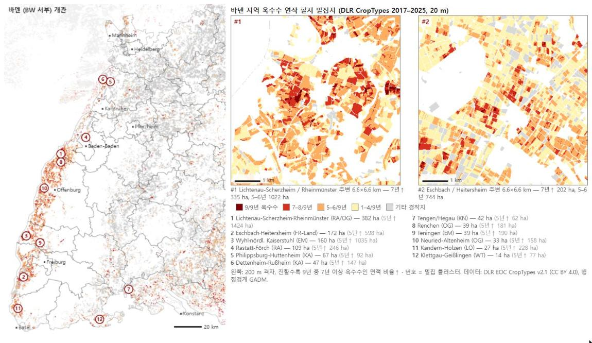

# 바덴 지역 옥수수 연작 필지 밀집지 분석

- 작성일: 2026-11-05
- 분석 기간: 2017–2025 (9개 연도)
- 분석 범위: Baden-Württemberg 전역 (결과는 바덴 지역 중심)

---

## 1. 요약

- 바덴에서 같은 작물을 몇 년씩 이어 심는 연작은 사실상 **옥수수 하나**예요.
- 연작 필지가 가장 많이 모인 곳은 **Lichtenau–Rheinmünster 일대(Rastatt/Ortenau 경계)**로, 9년 중 7년 이상 옥수수였던 땅이 약 382 ha예요.
- 그다음은 Eschbach/Heitersheim(Breisgau-Hochschwarzwald), Wyhl/북부 Kaiserstuhl(Emmendingen), Rastatt-Förch, Philippsburg·Dettenheim(LK Karlsruhe) 순이에요.
- **남부 오버라인 평야는 옥수수를 아주 많이 심지만, 9년 내내 옥수수인 땅은 드물어요.**
  - Ortenaukreis는 경작지의 54%가 9년 중 5년 이상 옥수수였지만, 7년 이상은 5%뿐이에요.
  - 옥수수 해충(Maiswurzelbohrer) 규제로 같은 밭에 3년 중 2번까지만 옥수수를 심게 한 영향이 유력해요.
- BW 전체로 넓히면 연작 면적 1위는 바덴이 아니라 Württemberg 쪽 **Ravensburg(서부 Allgäu)**예요. 2,763 ha로, 경작지의 11%가 사료용 옥수수 연작이에요.

---

## 2. 지도

- **왼쪽 (개관 지도)**
  - 200 m 격자로 그렸어요.
  - 빨간색이 진할수록 9년 중 7년 이상 옥수수인 땅의 비율이 높아요.
  - 주황색은 옥수수가 5년 이상 나온 땅, 회색은 기타 경작지예요.
  - 번호는 아래 표의 밀집지 순위예요.
- **오른쪽 (확대 지도)**
  - 밀집지 #1(Lichtenau-Scherzheim)과 #2(Eschbach)를 20 m 해상도로 확대했어요.
  - 각 화소를 9년 중 옥수수였던 연수에 따라 색칠했어요.
    - 진한 적색: 9/9년
    - 적색: 7–8/9년
    - 주황: 5–6/9년
    - 연노랑: 1–4/9년
    - 회색: 기타 경작지

---

## 3. 분석 방법

| 항목 | 내용 |
|---|---|
| 데이터 | DLR EOC **CropTypes v2.1** (독일 전역 연간 작물분류 지도, Sentinel-1/2 기반, CC BY 4.0) |
| 연도 | 2017–2025, 9개 연도 |
| 해상도 | 원본 10 m를 **20 m 개요 레벨**(최근접 샘플링)로 읽음. 매년 같은 지점을 표본으로 쓰므로 연도별 비교에 문제가 없음 |
| 연작 정의 | 같은 화소가 **9년 중 7년 이상 옥수수**(클래스 30)일 때. 해마다 생기는 분류 오류 1–2년치를 견딜 수 있게 정한 기준 |
| 보조 지표 | 9년 중 5년 이상 옥수수 (옥수수 위주 윤작) / 9년 모두 옥수수 (완전 연작) |
| 경작지 정의 | 9년 중 6년 이상 일년생 경작 작물로 분류된 화소 (초지·과수·포도·홉 제외) |
| 밀집지 정의 | 1 km 격자에서 3×3 km 창 안의 연작 면적이 **40 ha 이상**인 칸들을 이어 붙인 클러스터 |
| 지명 | 각 클러스터에서 연작이 가장 몰린 1 km 칸 중심 좌표로 OSM Nominatim 역지오코딩 |
| 행정경계 | GADM 기반 Landkreis 경계 (deutschlandGeoJSON) |

---

## 4. 연작 밀집지 순위 (바덴)

| # | 위치 | Kreis | 7년↑ 옥수수 (ha) | 9/9년 (ha) | 5년↑ 옥수수 (ha) | 클러스터 내 경작지 (ha) | 7년↑ 비율 | 중심 좌표 (위도, 경도) |
|---|---|---|---:|---:|---:|---:|---:|---|
| 1 | Lichtenau-Scherzheim / Rheinmünster | Rastatt · Ortenaukreis | 382 | 44 | 1,424 | 1,824 | 21.0% | 48.7081, 7.9943 |
| 2 | Eschbach / Heitersheim | Breisgau-Hochschwarzwald | 172 | 10 | 598 | 1,460 | 11.8% | 47.8946, 7.6488 |
| 3 | Wyhl am Kaiserstuhl / 북부 Kaiserstuhl | Emmendingen | 160 | 4 | 1,035 | 1,639 | 9.7% | 48.1648, 7.6686 |
| 4 | Rastatt-Förch | Rastatt · Baden-Baden | 109 | 3 | 246 | 345 | 31.7% | 48.8179, 8.2374 |
| 5 | Philippsburg-Huttenheim | LK Karlsruhe | 67 | 15 | 92 | 382 | 17.4% | 49.2059, 8.4237 |
| 6 | Dettenheim-Rußheim | LK Karlsruhe | 47 | 0 | 147 | 292 | 16.3% | 49.1881, 8.4513 |
| 7 | Tengen (Hegau) | Konstanz | 42 | 9 | 62 | 158 | 26.8% | 47.8211, 8.6663 |
| 8 | Renchen | Ortenaukreis | 39 | 1 | 181 | 241 | 16.1% | 48.6541, 7.9954 |
| 9 | Teningen | Emmendingen | 39 | 2 | 190 | 213 | 18.4% | 48.1213, 7.8042 |
| 10 | Neuried-Altenheim | Ortenaukreis | 33 | 1 | 158 | 303 | 10.9% | 48.4816, 7.8363 |
| 11 | Kandern-Holzen | Lörrach | 27 | 1 | 228 | 259 | 10.4% | 47.6870, 7.6009 |
| 12 | Klettgau-Geißlingen | Waldshut | 14 | 0 | 77 | 115 | 11.9% | 47.6219, 8.3880 |

- "7년↑ 비율"은 클러스터 안 경작지 대비 7년 이상 옥수수 면적이에요.
- 확대 지도 범위(6.6 × 6.6 km)로 보면 #1 주변은 7년↑ 335 ha·5–6년 1,022 ha, #2 주변은 7년↑ 202 ha·5–6년 744 ha예요.

---

## 5. Kreis별 통계 (바덴 지역, 7년↑ 옥수수 30 ha 이상)

| Kreis | 경작지 (ha) | 5년↑ 옥수수 (ha) | 7년↑ 옥수수 (ha) | 9/9년 (ha) | 7년↑ 비율 |
|---|---:|---:|---:|---:|---:|
| Ortenaukreis | 25,982 | 14,017 | 1,354 | 38 | 5.2% |
| Breisgau-Hochschwarzwald | 17,822 | 5,814 | 620 | 24 | 3.5% |
| Rastatt | 9,421 | 4,039 | 612 | 45 | 6.5% |
| Emmendingen | 9,240 | 4,682 | 578 | 22 | 6.3% |
| Konstanz | 18,337 | 2,905 | 538 | 40 | 2.9% |
| LK Karlsruhe | 27,937 | 1,835 | 341 | 32 | 1.2% |
| Waldshut | 13,688 | 1,924 | 252 | 7 | 1.8% |
| Lörrach | 6,346 | 2,693 | 233 | 11 | 3.7% |
| Schwarzwald-Baar-Kreis* | 13,551 | 1,227 | 196 | 9 | 1.4% |
| Rhein-Neckar-Kreis | 27,083 | 1,106 | 102 | 1 | 0.4% |
| Neckar-Odenwald-Kreis | 35,811 | 998 | 96 | 10 | 0.3% |
| Main-Tauber-Kreis | 56,671 | 594 | 76 | 10 | 0.1% |
| Stadt Freiburg | 1,296 | 554 | 57 | 2 | 4.4% |
| Stadt Baden-Baden | 474 | 205 | 57 | 1 | 12.1% |
| Stadt Karlsruhe | 1,608 | 218 | 39 | 0 | 2.4% |
| Enzkreis* | 11,932 | 402 | 35 | 0 | 0.3% |

\* 역사적 바덴과 Württemberg에 걸쳐 있는 Kreis예요.

**비교용 (BW 전체 및 Württemberg)**

- BW 전체: 경작지 779,624 ha, 5년↑ 옥수수 91,455 ha, 7년↑ 옥수수 11,512 ha, 9/9년 1,343 ha
- Ravensburg: 7년↑ 2,763 ha (경작지의 10.9%), 9/9년 789 ha → BW 최대 연작 지역 (서부 Allgäu의 사료용 옥수수)
- Biberach 830 ha, Bodenseekreis 617 ha도 상위권

---

## 6. 주요 발견

1. **바덴의 연작 밀집지는 오버라인 평야 띠를 따라 이어져요.** 북쪽 Karlsruhe 부근(Philippsburg·Dettenheim)부터 Rastatt, Ortenau, Kaiserstuhl 주변, Markgräflerland(Eschbach·Kandern)까지 라인강 동쪽 평야예요.
2. **옥수수 비중은 높지만 9년 내내 옥수수인 땅은 적어요.** Ortenau·Emmendingen·Breisgau는 9년 중 5년 이상 옥수수인 땅이 매우 넓은데, 9/9년 완전 연작은 Kreis마다 20–40 ha 수준이에요.
3. **해충 규제와 결과가 맞아떨어져요.** 해충 발생 이후 Ortenau·Emmendingen에서는 감염 필지와 인접 필지에 3년 중 2번까지만 옥수수를 허용했어요. 실제로 "옥수수-옥수수-다른 작물" 순환이 흔하게 나타나요.
4. **기존 자료와도 맞아요.**
   - 주 통계청(2010)은 남부 오버라인의 경작지 절반 이상이 옥수수이고, 일부 농가가 옥수수만 연이어 심는다고 기록했어요.
   - RP Freiburg 포획 통계에서도 해충이 Ortenau, Breisgau-Hochschwarzwald, Emmendingen에 가장 많아요.
5. **바덴 밖에서는 사정이 달라요.** Allgäu·Oberschwaben처럼 초지가 많은 낙농 지역은 몇 안 되는 밭에 사료용 옥수수를 매년 심어서, 완전 연작 비율이 더 높게 나와요.

---

## 7. 다른 작물 확인

일년생 경작 작물 16개 클래스 모두에 대해 "9년 중 7년 이상 같은 클래스"인 면적을 확인했어요.

| 클래스 | BW 전체 (ha) | RB Freiburg + Karlsruhe (ha) | 해석 |
|---|---:|---:|---|
| 옥수수 (30) | 11,502 | 5,378 | 실제 연작 |
| 채소·딸기 (120) | 5,147 | 3,152 | 아스파라거스·딸기 같은 다년생이 대부분일 것으로 보여 연작에서 제외 |
| 호밀 (13) | 456 | 454 | 소규모, 검증하지 않음 |
| 기타 클래스 | 각 140 이하 | 각 25 이하 | 무시해도 되는 수준 |

---

## 8. 한계

- **공식 필지 경계가 아니에요.** 20 m 위성 분류 결과라서 필지 단위로 확정하려면 비공개인 농지 신청(IACS/FIONA) 데이터가 필요해요.
- **분류 오차가 있어요.** 옥수수 분류 정확도(F1)는 해마다 약 0.72–0.93이에요.
- **BW 정확도는 더 낮을 수 있어요.** 학습 데이터에 BW 공식 농지 자료(LPIS)가 들어가지 않았어요.
- **좁은 밭은 덜 정확해요.** Ortenau처럼 띠 모양으로 좁은 밭이 많은 곳에서는 20 m 화소가 경계에 걸쳐 정확도가 떨어질 수 있어요.
- **행정경계로 바덴을 근사했어요.** "바덴"은 역사적 경계 대신 RB Freiburg·Karlsruhe 중심의 Kreis로 잡았어요.

---

## 9. 출처

- DLR EOC Geoservice, *CropTypes – Crop Type Maps for Germany, Yearly, 10 m* (v2.1, CC BY 4.0): https://geoservice.dlr.de/web/datasets/croptypes_de
  - 파일·범례·정확도: https://download.geoservice.dlr.de/CROPTYPES/files
- Statistisches Landesamt BW, *Statistisches Monatsheft* 3/2010, „Eine Erfolgspflanze mit Migrationshintergrund: Mais“: https://www.statistischebibliothek.de/mir/servlets/MCRFileNodeServlet/BWMonografie_derivate_00001033/Beitrag10_03_08.pdf
- RP Freiburg, Maiswurzelbohrer 포획 현황 포스터: https://rp.baden-wuerttemberg.de/fileadmin/RP-Internet/Freiburg/Abteilung_3/Referat_33/Mais-Sojainfofahrt2023/Poster_MWB.pptx.pdf
- Thünen-Institut, *Agricultural land use (raster), crop type maps for Germany 2017–2021* (대체 데이터): https://zenodo.org/records/10640528
- 행정경계: deutschlandGeoJSON (GADM 기반), 지명: OpenStreetMap Nominatim
